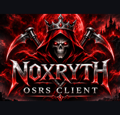

  

# Noxryth OSRS Client

A Windows companion application for Old School RuneScape featuring a custom red and black gothic interface.

## Current Version

**v0.4.0 - Public Beta (Available Now)**

## Features

- Account registration and login
- Email verification
- Password recovery
- Account-based permissions
- Administrative user management
- Python script library
- Mining, Fishing and Woodcutting demo modules
- Experimental fishing screenshot detector
- Session statistics and activity logs
- Custom profiles and settings
- Standalone Windows executable

## Account Roles

| Role | Access Level |
|---|---|
| Owner | Project administration |
| Admin | Authorized user management |
| Developer | Developer role |
| Beta Tester | Beta testing role |
| Member | Standard client access |

## Downloads

The Noxryth v0.4.0 Public Beta is officially available!

[Download Noxryth v0.4.0 for Windows](https://github.com/smokenpackz/Noxryth-OSRS-Client/releases/download/v0.4.0-beta/Noxryth_v0.4.0_Windows.zip)

[View Release Notes](https://github.com/smokenpackz/Noxryth-OSRS-Client/releases/tag/v0.4.0-beta)

## Installation

1. Download the Windows ZIP package.
2. Extract all files.
3. Launch Noxryth.exe.
4. Create an account or log in.
5. Verify your email when registering.

## System Requirements

- 64-bit Windows
- Internet connection for authentication
- No separate Python installation required

## Official Community

[Join the Noxryth Discord](https://discord.gg/UaBPKDTRC8)

## Account Center

[Visit the Noxryth Account Center](https://smokenpackz.github.io/Noxryth-OSRS-Client/)

## Download Verification

SHA-256 checksum:

6073e07699ae44b9accb341e81f8c8c28d2010a85b29662d4885543c6cd606d8

Use this checksum to verify the integrity of your download.

## Beta Notice

Some features are experimental and may produce inaccurate results. Demonstration modules do not send inputs to RuneScape.

Please report bugs and provide feedback through our official Discord server.

## Disclaimer

Noxryth is an independent project and is not affiliated with Jagex or RuneLite.

**Copyright 2026 Noxryth.**
